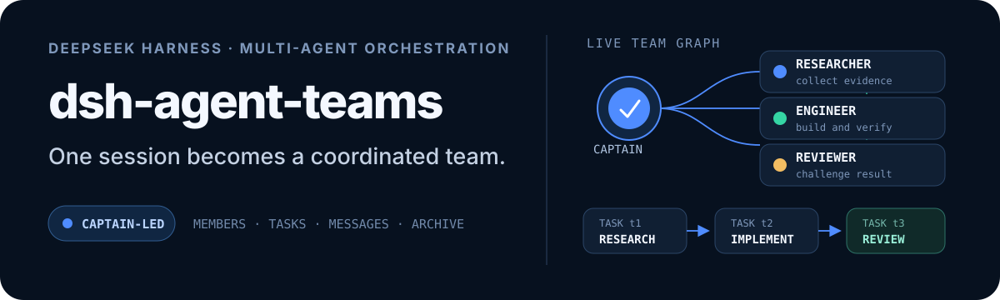
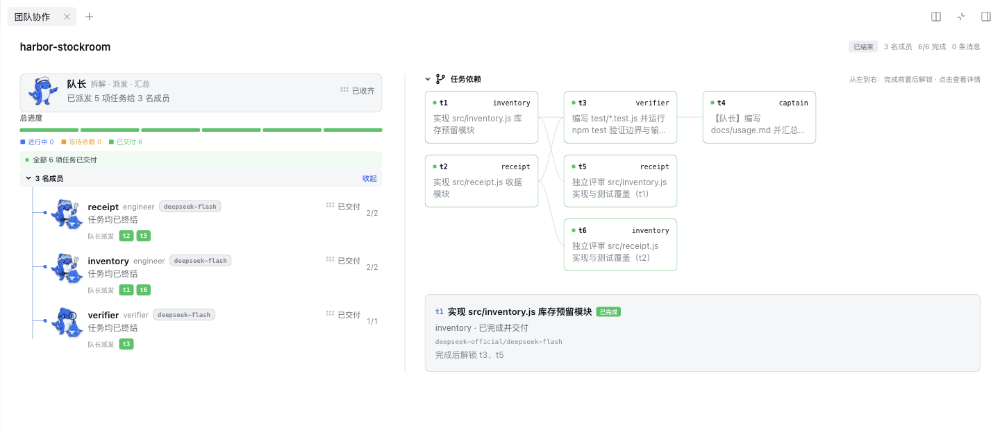

<p align="right">
  <a href="./README.md">English</a> · <strong>简体中文</strong>
</p>

<p align="center">
  
</p>

<div align="center">

[](https://atomgit.com/NanmiCoder/dsh-agent-teams)

</div>

<p align="center">
  <a href="https://dshfind.com/zh/plugins/NanmiCoder/dsh-agent-teams?ref=badge"></a>
  <a href="https://dshfind.com/zh/plugins/NanmiCoder/dsh-agent-teams?ref=badge"></a>
  <a href="https://dshfind.com/zh/plugins/NanmiCoder/dsh-agent-teams?ref=badge"></a>
</p>

<p align="center">
  <a href="https://www.npmjs.com/package/@nanmicoder/dsh-agent-teams"></a>
  <a href="./LICENSE"></a>
  <a href="./cordis.patch.yml"></a>
</p>

## 一句话，拉起一支真正协作的团队

`dsh-agent-teams` 让当前 DeepSeek Harness 会话成为队长：创建可续聊的子 Agent、把目标拆成有依赖的任务，并通过直达消息协调成员工作。

你只需用自然语言提出目标。插件会提供精简的固定团队协议、14 个业务工具、持久化状态、自动共享任务调度和实时 Web UI，不需要额外的 Workflow 引擎。

<p align="center">
  
</p>

## 版本更新

[最新发布](https://github.com/NanmiCoder/dsh-agent-teams/releases/latest) 修复在 Harness `0.2.1-rc.4`、`0.2.1-rc.5`（npm `latest`）及之后版本上无法安装的问题。插件不再逐个列出已测宿主，只声明最低宿主版本 `>=0.1.2-alpha.2`，Harness 发布新版本不会再挡住安装。npm 安装请写明下方的版本号，GitHub 安装使用默认分支。推荐宿主仍为 `0.2.1-rc.2`。详见[测试矩阵](./compatibility.json)和[发布说明](./release-notes/v0.1.28.md)。

## 为什么需要 AgentTeams？

| 能力 | 带来的变化 |
| --- | --- |
| **队长式委派** | 当前会话负责建队、分配角色并汇总最终结果。 |
| **可续聊成员** | 成员是可持续唤醒的 DSH 子 Agent，可以继续执行聚焦的后续轮次。 |
| **带依赖的任务** | 任务有明确状态；依赖未完成时不能领取。 |
| **自动续领与安全接管** | 成员空闲后自动领取下一项就绪任务；转派会撤销旧 attempt，冷恢复会重试遗留任务，迟到结果无法覆盖。 |
| **成员直达消息** | 成员通过持久化邮箱直接联系队友或队长，不需要队长中转。 |
| **实时活动面板** | Web UI 用分段进度、可折叠成员树和可交互 DAG 展示实时工作；运行中的子任务会标出使用的模型，团队结束后仍保留完整成员与任务历史。 |
| **质量门禁** | 人只提供目标和约束。默认任务顺序是需求 → 实现 → 验证 → 审查 → 集成，失败后自动修复/复审，恢复团队必须显式 resume。第一版范围控制是完成时审计，不是 host 写入拦截。详见 [docs/quality-gates.md](./docs/quality-gates.md)。 |

对话卡片与活动面板接入 Harness 官方多语言服务，会随宿主在简体中文和英文之间实时切换；任务/成员状态、动态摘要、操作按钮、历史归档标识和无障碍文案都会同步更新，无需刷新页面，也不增加插件自己的语言设置。

## 安装与版本选择

**推荐组合：DeepSeek Harness `0.2.1-rc.2` + AgentTeams `0.1.28`。宿主仍为 RC 版本。**

| 使用场景 | DeepSeek Harness | AgentTeams 插件 |
| --- | --- | --- |
| **推荐版本** | **`0.2.1-rc.2`** | **`0.1.28`** |
| 预览宿主 | `0.2.1-rc.3` | `0.1.28` |
| 上一推荐 RC | `0.2.1-rc.1`, `0.2.0-rc.2`, `0.1.7-rc.2` | `0.1.28` |
| 保留旧 RC | `0.1.5-rc.1`, `0.1.5-rc.2`, `0.1.5-rc.3` | `0.1.28` |
| 保留旧 RC | `0.1.2-rc.1` | `0.1.28` |
| 开发者测试 Alpha | `0.1.2-alpha.5` | `0.1.28` |
| 保留旧 Alpha | `0.1.2-alpha.2` | `0.1.28` |
| 更新的宿主 | `0.2.1-rc.4`、`0.2.1-rc.5` 及之后版本 | `0.1.28` |

除最后一行外均为 CI 测试矩阵。`0.2.1-rc.4` 及之后发布的 Harness 都可以直接安装；`0.2.1-rc.5` 已在本地 macOS 跑通完整运行场景，尚未加入 CI 矩阵。

### 桌面端

在应用侧栏打开「插件 → 添加插件」，可以直接通过 GitHub 地址安装。在插件输入框中粘贴下面的仓库地址，无需追加版本号、tag 或 commit：

```text
https://github.com/NanmiCoder/dsh-agent-teams
```

此方式从默认分支安装，刚发布后即可使用。也支持下面的等价简写：

```text
github:NanmiCoder/dsh-agent-teams
```

从 npm 安装时输入带版本号的包名 `@nanmicoder/dsh-agent-teams@0.1.28`。桌面端的 pnpm 11 默认不自动安装发布未满 24 小时的版本：新版发布后的 24 小时内，不带版本号或使用 `@latest` 都会装到上一个版本，即使预览显示的是新版；如果上一个版本与你的宿主不兼容，安装会失败。写明版本号可以立即安装该版本；更换镜像源不会消除这项规则。GitHub 方式需要能够访问 GitHub，默认分支代码可能先于 npm 发布。

安装完成后点击「立即启用」；宿主提示需要重启时，重启桌面应用。无需关闭兼容检查或全局发布等待期规则。

桌面端自带 Harness 内核与包管理器，升级全局 CLI 不会升级桌面端；普通独立 CLI 不能管理桌面 profile，桌面端自带的 CLI carrier 在此版本可以管理。当前精确目标是已发布的 `0.2.1-rc.2`，仍属于 RC；此前源码预测的 `0.2.0` 已退出支持声明。详见[迁移验收记录](./docs/harness-0.2.1-rc.2/README.md)。

### CLI / Web：1. 安装 DeepSeek Harness

```sh
npm install --global @deepseek-ai/dsh
dsh --version
```

此命令安装宿主的 npm `latest`；升级后请用 `dsh --version` 对照兼容清单。Alpha 仅供主动测试：手动指定表中的 Alpha 版本，并按[维护指南](./docs/maintenance-workflow.md)锁定整组宿主依赖。

### CLI / Web：2. 安装 AgentTeams 插件

从 npm 安装或升级插件时写明版本号（当前正式版为 `0.1.28`）：

```sh
dsh plugin --profile web add --save-exact @nanmicoder/dsh-agent-teams@0.1.28
```

CLI 管理的安装可将 `web` 换成实际使用的 CLI profile。**安装后，停止并重新启动该 profile 的 Harness 进程，再刷新浏览器。** 安装插件不会自动升级宿主；Harness 的 `latest` 与插件的 `latest` 是两个独立渠道。

也可以从 GitHub 默认分支安装或更新，无需追加 tag 或 commit：

```sh
dsh plugin --profile web add github:NanmiCoder/dsh-agent-teams
```

更新时把命令里的版本号换成新版本再运行，然后重启对应 profile；已有安装只重复裸包名时，包管理器可能保留旧的精确版本。不带版本号或使用 `@latest` 时，新版发布后的 24 小时内会装到上一个版本。镜像源尚未同步新发布时，可在 npm 命令后追加 `--registry=https://registry.npmjs.org`。GitHub 默认分支的代码可能先于 npm `latest` 发布；默认分支包含已验证的 `lib/` 构建产物。仓库随代码分发服务端、客户端和类型产物，安装时不需要执行 `prepare` 或批准构建脚本。源码维护者每次修改源码后，都需运行 `pnpm build` 并更新已提交的产物。已经发布的 npm 产物保持不变。

手动克隆源码的用户，拉取代码后需重新运行 `pnpm install --frozen-lockfile` 和 `pnpm build`，再重启对应的 Harness；只更新 Git 不会更新本地构建产物。详见[维护指南](./docs/maintenance-workflow.md)。

> 低于 `0.1.2-alpha.2` 的旧 `0.1.0-*` / `0.1.1-*` 宿主，请先保留已工作的组合，参考[旧版本与诊断指引](./docs/maintenance-workflow.md)。

完整[兼容清单](./compatibility.json)、[源码安装与 Alpha 验证](./docs/maintenance-workflow.md)、[已验证范围与平台限制](./docs/maintenance-2026-09-06/release/README.md)。

接着直接用自然语言拉团队：

> 使用 AgentTeams 审查 v0.5.3 之后的提交，分别从性能、安全和产品角度分工，最后输出一份汇总报告。

队长会话从第一轮起保留精简的固定核心协议和原有 14 个业务工具，直接调用，无需额外的加载工具或激活调用。已配置模板的精简目录固定保留。创建、批准、继续或结束团队都不会改写系统提示词和工具 schema，会话压缩或代码模式丢弃工具结果也不会丢失核心规则。成员保留四个团队工具、固定成员说明及普通编程/研究工具。Web 批准后会通知并唤醒队长，后续成员报告会再次唤醒它，无需忙轮询。详见[固定协议与 benchmark 标准](./docs/progressive-loading.md)。

## 在工作区查看团队

从当前聊天标题栏或回复下方的团队卡片点击 **查看团队**，在原生「团队协作」标签页中查看成员分工、任务依赖和执行进度。入口跟随所属聊天，不放在通用工作区开始页。

页面直接呈现团队和任务内容；宽屏并排展示，窄分栏自动堆叠。点击任务可定位负责成员，成员图标可打开对应会话。关闭标签页不会停止团队；回到所属聊天可以再次打开。已完成团队保留归档，旧宿主继续使用活动面板。

## 工作方式

1. 当前会话创建团队并成为队长。
2. 队长按角色添加由可续聊子 Agent 驱动的成员。
3. 目标被拆成有负责人和显式依赖的任务。
4. 共享调度器依据真实 `running / idle / ready` 状态，为每个空闲成员原子领取一项就绪任务并唤醒它；驻留成员被中断时会停驻当前 attempt，可通过直接消息继续而不丢 capability；只有冷进程重启后的遗留任务才会生成新 attempt 恢复。
5. 成员携带当前 `attempt_id` 更新任务；转派或队长接管会先撤销旧 attempt、等待原成员安静，再启动新 attempt。
6. 队长汇总结果，随后归档完整团队记录。

团队状态保存在 `<workspace>/.agent-teams/`；Web 面板读取这份磁盘真相，并与实时子 Agent 活动合并展示。

成员创建默认零交互：成员沿用队长当前 LLM 路由时会快照该 provider、model 与思考强度；用户要求改用其他路由时，则快照目标模型的默认强度，成员后续续跑仍使用最终解析出的快照。只有当用户明确提出异构分工（例如“后端用 provider A/model X，前端用 provider B/model Y”）时，队长才会把对应的 `provider` + `model` 传给该成员；不会逐个弹出模型或思考强度选择。

## Slash 命令

无需再说“用 AgentTeams”。插件注册了封闭命名空间的 `/agent-teams` 宿主命令，Web GUI 的 slash 菜单会显示 `agent-teams` 占位项与输入提示：选中它（或直接输入命令）、描述目标、回车即可。

```
/agent-teams 调研三家竞品的定价页
```

这一行被命令管线认领后，会按用户提交的原文作为普通用户消息送入主会话，因此聊天记录中仍能看到完整的 `/agent-teams …`。手势边界会在 pre-step 注入确定性激活指令，队长协议仍会立即启动。调用也会持久化记录（`command/run` / `command/done`）。

没有命令裁决的表面（例如 headless CLI）也享有同等的确定性激活：任何以 `/agent-teams` 开头的真实用户消息，都会为其余文本激活该协议；句子中间出现的字样仍是普通文本。

## 配置

默认配置可以直接使用。受信任的 Profile 可以覆盖成员行为：

```yaml
- id: agent-teams
  config:
    stateDir: .agent-teams
    memberProvider: spawn
    memberModel: deepseek-v4
    memberMaxDepth: 0
    maxMembers: 8
    toolPolicies:
      researcher:
        allow: [read, glob, grep]
      implementer:
        deny: [web_search]
```

`memberMaxDepth` 默认 `0`，团队成员不能再创建子代理；显式设为 `1` 可允许一层后代，运行时和代码工具调用同样受限。默认成员统一通过团队消息汇报，避免再走宿主消息重复通知队长。无任务成员不调用模型；任务分配开启独立轮次，纠正消息进入最近的模型步骤。消息投递与读取分别记录；移除和归档必须等成员分支及待处理输入清理完成后才报告成功。

`toolPolicies` 是部署方配置：按 id 复用的成员工具策略。成员只能“按 id 选择”——`agent_teams_add_member` 的 `tool_policy`、内联 `plan` 的成员行，或 profile 成员行的 `tool_policy`。队长模型只能选择已声明的策略，不能提交原始 allow/deny 列表，也不能在运行时新建策略。

- `deny` 让指定全局工具从该成员的 schema 中消失，并拒绝其调用。
- `allow` 只保留列出的全局工具；四个协调工具（`agent_teams_claim_task`、`agent_teams_update_task`、`agent_teams_send_message`、`agent_teams_status`）始终会被加入 allow 列表。
- 队长专属工具始终被拒绝，策略无法重新打开；策略也不允许拒绝必须保留的协调工具。
- 未知 id、空策略、空列表会在挂载时或写入成员前直接失败。
- `agent_teams_status` 会显示每个成员选择的策略 id；完整生效过滤器保存在 `team.json` 供审计，重启后由子会话的持久 descriptor 重新应用。
- 未配置策略的团队与成员保持原有工具集和记录结构；`agent_teams_edit_plan` 传空 `tool_policy` 可清除暂存成员的策略。

这是全局工具的模型可见性与调用限制，不是 OS 沙箱，也不是授权边界。

普通调研、仓库审计可用 `agent_teams_create({name, description, approval:"required", plan:{members:[{name:"researcher"}], tasks:[{id:"audit", subject:"审计现有实现", assignee:"researcher"}]}})` 一次创建完整草案。任务的 `dependencies` 引用同一批中的 `id`，支持前向引用并校验环；结果返回实际任务 ID。`kind=review` 专用于对既有 implementation/repair 任务的质量复审，普通仓库审计使用默认的 `kind=work`。

这里的 `memberProvider` 指子 Agent 的运行后端（`spawn` / `fork`），不是 LLM provider。跨 LLM provider 由 `agent_teams_add_member` 的可选 `provider` + `model` 参数表达；`memberModel` 只是所有成员的模型默认覆盖。成员沿用队长当前 provider/model 时会继承队长的思考强度；provider 或 model 任一改变时会自动使用目标模型的默认档。需要指定特定强度时，可传入可选的 `reasoning_effort` 参数（目标模型支持的档位 id，或 `"default"` 表示强制使用模型自身默认档）。

`slashCommand: false` 可关闭确定性的 `/agent-teams` 激活面（slash 命令与手势边界），仅保留自然语言触发。

## 使用边界

- 一个队长同一时间只能带一个活动团队。
- 没有开放任务的空闲成员会自动续领就绪任务；仍持有开放 attempt 的空闲成员会停驻，队长可发消息让其沿用原 attempt 继续，或显式转派；冷重启遗留的开放任务才会生成新 attempt。暂时无法实时投递的消息会持久保存在邮箱中并在后续状态边界重投。
- 状态使用文件持久化，并在单个 DSH 进程内串行操作；多个进程同时修改同一团队不保证一致。
- 历史面板依赖保存的团队状态或归档；早期版本删除团队时未保留归档的会话，暂不支持从日志重建完整面板。
- 活动面板如实展示持久化状态；模型偶尔可能完成工作却没有按协议更新任务状态。

完整工具列表、状态模型、Web UI 行为、配置与已知限制见 [docs/usage.md](./docs/usage.md)。

## 插件开发 Skill

仓库已引入社区升级、审计、测试和发布 skills，来源与本项目规则见 [skills/README.md](./skills/README.md)，贡献入口见 [CONTRIBUTING.md](./CONTRIBUTING.md)。

另提供开放 Agent Skills 包 [`dsh-plugin-development`](./skills/dsh-plugin-development/SKILL.md)：

```sh
npx skills add NanmiCoder/dsh-agent-teams --skill dsh-plugin-development
```

## 文档

| 指南 | 内容 |
| --- | --- |
| [使用指南](./docs/usage.md) | 架构、UI 行为、工具、配置、限制与验证 |
| [验证指南](./docs/verification-guide.md) | 离线、组合、真实 e2e 与 GUI 验证 |
| [插件开发](./docs/developing-dsh-plugins.md) | 基于本插件整理的人类可读开发指南 |
| [README 写作](./docs/readme-writing-guide.md) | 仓库文档约定 |

## 开发

```sh
pnpm install
pnpm build
pnpm verify
```

## 命名多角色团队配置

在 `cordis.patch.yml` 的 `profiles` 中配置完整团队模板。每个 profile 都提供成员阵容，可独立指定 provider、model、role、reasoning_effort。`taskPlanning: captain` 表示只提供阵容和约束，由 Captain 根据用户目标设计 DAG；省略该字段或设为 `seed` 时，展开模板中的固定任务图。使用 `/agent-teams --profile <名称> <目标>` 显式激活；不会把首个普通 token 隐式识别为 profile。

普通 `/agent-teams` 流程继续已有团队，按需调用 `agent_teams_status` 确认状态；仅在没有当前团队时调用 `agent_teams_create({ profile, approval: "required" })`：只落盘可编辑的成员占位和 DAG，不创建子会话、不领取任务。成员模型和推理等级直接读取 Harness 的模型目录。「返回对话修改」会终止仍在运行的规划轮次，让队长先追问修改方向，再用一次原子操作更新同一份草案；「放弃本次计划」经二次确认后会归档草案、中止轮次，并向模型注入不得自动重建团队的控制上下文。只有点击「确认并启动团队」才会提交最终配置并调度就绪任务；成员有就绪任务时才创建会话。运行中团队的停止入口位于该团队的面板标题，点击后需要二次确认，不再占用输入区域。直接工具调用方可显式传 `approval: "automatic"` 保留旧的立即执行路径。审查或测试失败不会解锁下游；自动 repair/review 不依赖 failed review。

## 许可证

[MIT](./LICENSE)
